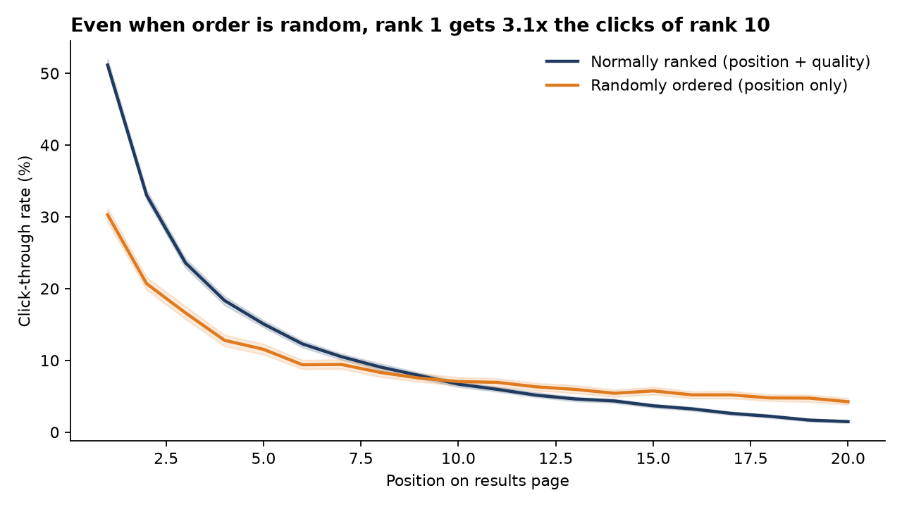
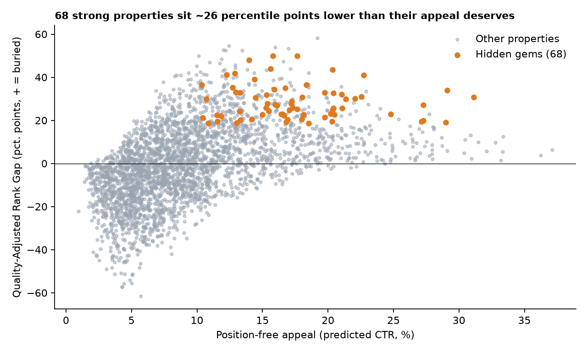
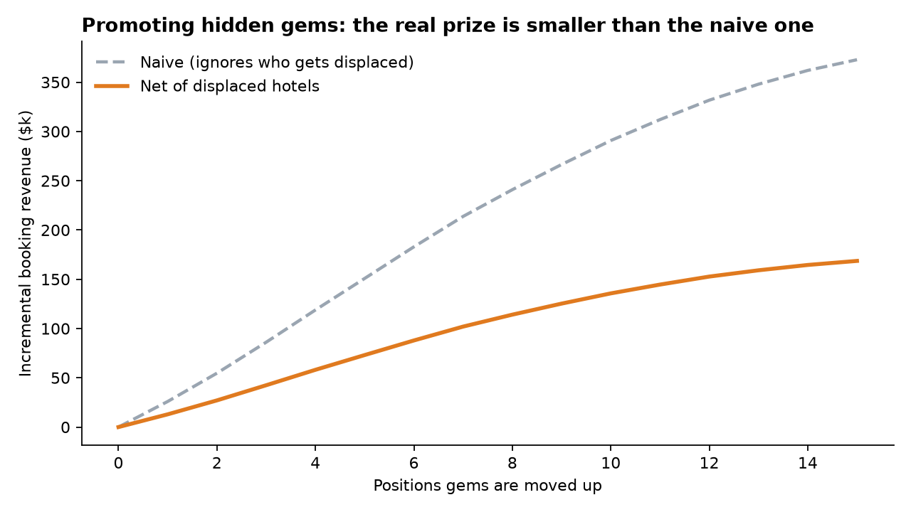
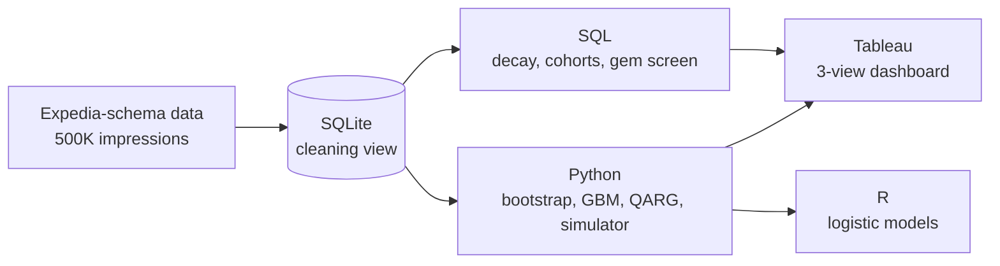

# The Rank Tax

### What is position #1 actually worth on a travel site?


Hotels at the top of a results page get booked more. But is that because they are **better**, or just because they are **on top**? Ranked data can't tell you, because the ranker puts good hotels first. Expedia's public dataset can, thanks to one overlooked column: `random_bool`, which marks searches where hotels were shown in **random order**. That is a built-in randomised experiment. This project uses it to measure the "rank tax" and to find the good hotels that Expedia's ranking buries.

> **Data note.** All numbers below come from a 500K-impression **synthetic** dataset with the exact schema of Kaggle's *Personalize Expedia Hotel Searches*. They show that the method works, not what Expedia's true values are. The whole pipeline re-runs on the real file with one command (see [Reproduce](#reproduce)).

<!-- Add a screenshot of your Tableau dashboard here, then delete this comment -->
<!--  -->

**[Open the interactive Tableau dashboard](https://prod-in-a.online.tableau.com/#/site/shreyanshsakarwal512-0f28978c21/workbooks/1870740?:origin=card_share_link)**

---

## The result in 30 seconds

| | |
|---|---|
| **54% vs 72%** | Share of bookings captured by the top 5 slots (25% of the page) when order is random vs. normally ranked. |
| **~61%** | Share of the top-5 advantage that is position alone, not hotel quality. |
| **−0.61 vs −1.10** | CTR elasticity to position, random vs. ranked. Naive analysis of ranked data **overstates** position effects. |
| **2.2x → 5.6x** | Top-5 click premium for same-day vs. 90+ day bookers. Planners are 2.6x more rank-sensitive. |
| **68 hidden gems** | Strong properties ranked about 26 percentile points below what their appeal deserves. |
| **+2.7% net revenue** | Promoting the gems 10 slots, after subtracting the hotels they displace. Roughly **half** the naive estimate. |

---

## Findings

### 1. Position alone is worth a lot, and ranked data exaggerates it
Under random order, rank 1 still earns **3.1x** the clicks of rank 10. Normal rankings look steeper because they mix position with quality.



### 2. How much rank matters depends on how far ahead people book
Position penalty grows steadily with lead time (elasticity −0.375 for 0-1 day bookers to −0.812 for 90+ days). Last-minute bookers mostly ignore rank, so promotion budget is wasted on them.

### 3. A new metric finds the hotels the ranker misses
**Quality-Adjusted Rank Gap (QARG)** = actual position minus the position a hotel's position-free appeal deserves, as a percentile of the results list.

1. Train a gradient-boosted model **only on random-order searches**, with position excluded, so its "appeal" score is free of ranking bias (holdout AUC 0.68).
2. Apply it to normal searches to get each hotel's expected rank.
3. Average the gap per property. Gems are 4★+, review ≥ 4, at or below the average search price, and in the top quartile of QARG: **68 of 3,000 properties**.



### 4. What fixing it is worth, honestly
Moving a hotel up pushes another one down. The revenue simulator nets that out: promoting gems **5 / 10 slots** yields **+1.4% / +2.7%** net revenue. The naive estimate that ignores displaced hotels is about **2.1x** larger.



---

## How it's built



| Skill | Where it shows up |
|---|---|
| **SQL** | CTEs, window functions (`AVG OVER` frames, `LAG`, `FIRST_VALUE`, `COUNT OVER`, `NTILE`), a cleaning view, three analysis queries (`sql/`). |
| **Python** | Cluster bootstrap that resamples whole searches (not rows), a position-free GBM, shrinkage of small-sample CTRs, the QARG metric, the revenue simulator (`python/`). |
| **R** | Logistic regression with position × random-order and position × lead-time/stay interactions, odds ratios with Wald CIs, ggplot2 (`r/`). |
| **Tableau** | Three-view dashboard: decay curves, hidden-gem explorer, revenue simulator with a parameter control (`tableau/`). |
| **Visualisation** | Titles state the finding, every axis is labelled with units, one accent colour for what matters and grey for context, no dual axes. |

---

## What I'd do with this at Expedia

1. **Interleaving test:** run a 1-2% traffic test promoting QARG-flagged properties by 3-5 slots. Success metric: net bookings per search, not CTR.
2. **Ranking audit:** track QARG as a standing metric. Properties with a persistent gap point to missing features in the ranker.
3. **Targeting:** skip position promotion on last-minute searches, which respond least to rank.

---

## Reproduce

```bash
pip install pandas numpy scikit-learn matplotlib
mkdir -p data
python python/01_generate_synthetic.py   # synthetic data, Expedia schema
python python/02_load_db.py              # SQLite + cleaning view
python python/03_analysis.py             # bootstrap, GBM, QARG, simulator, figures
python run_sql.py                        # exports SQL results to outputs/sql/
Rscript r/04_position_model.R            # optional, needs R + ggplot2
```

Fixed seeds: re-running regenerates the committed `reports/results.json` exactly.

**On the real data:** download `train.csv` from the [Kaggle competition](https://www.kaggle.com/c/expedia-personalized-sort) and run `./run_all.sh /path/to/train.csv`. Nothing else changes. Check the price convention first (it may be per night or per stay depending on market), and expect "top 5 = 25% of the page" to change, since real pages have more than 20 hotels.

---

## Limitations

- **Synthetic data:** results show the method, not Expedia's real numbers. Revenue figures are simulation outputs.
- **Gem counts are partly by design:** 68 is the top quartile of an eligible pool, and the quoted QARG median describes that selected group. The SQL-only screen (13 gems) agrees with the Python list on only 2, so the gem list depends on the method.
- **Appeal uses observed features only:** unobserved quality is not captured, and the log-position form is an assumption.
- **Net revenue** ignores cross-search cannibalisation, price changes, and long-run satisfaction.
- **2013 data, one marketplace:** with modern data I'd use ongoing randomisation or interleaving on a small traffic slice.

---

## Repo map

```
sql/        position decay, booking-window cohorts, hidden-gem screen
python/     data generation, DB load, analysis
r/          logistic position model
tableau/    build guide + ready-to-load CSVs
reports/    executive summary, results.json, figures
outputs/    exported SQL results
run_all.sh  one-command pipeline
```

---

**Shreyansh Sakarwal** · B.Tech Data Science, Heritage Institute of Technology, Kolkata
[LinkedIn](https://linkedin.com/in/shreyansh-sakarwal-7a26a2323) · [GitHub](https://github.com/deBurglar) · shreyanshsakarwal512@gmail.com
